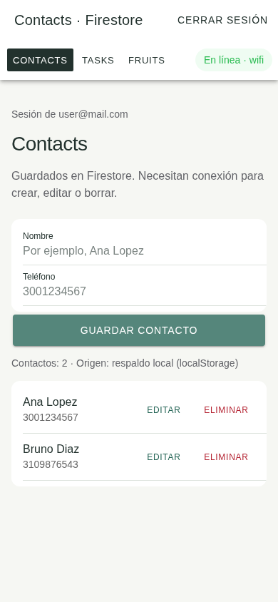
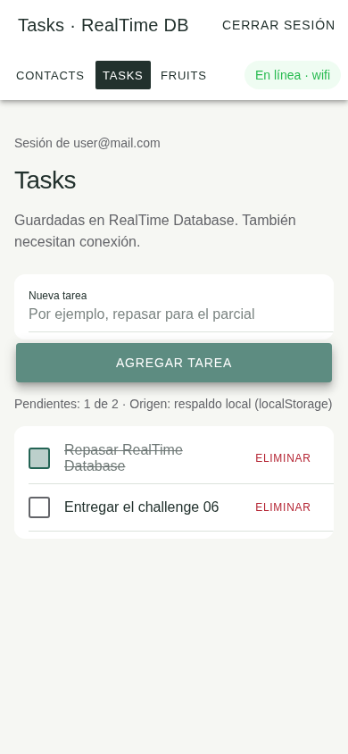
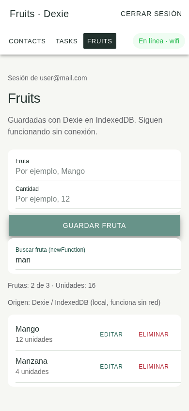
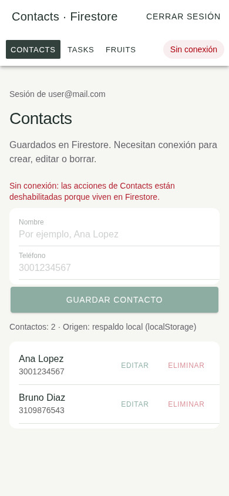
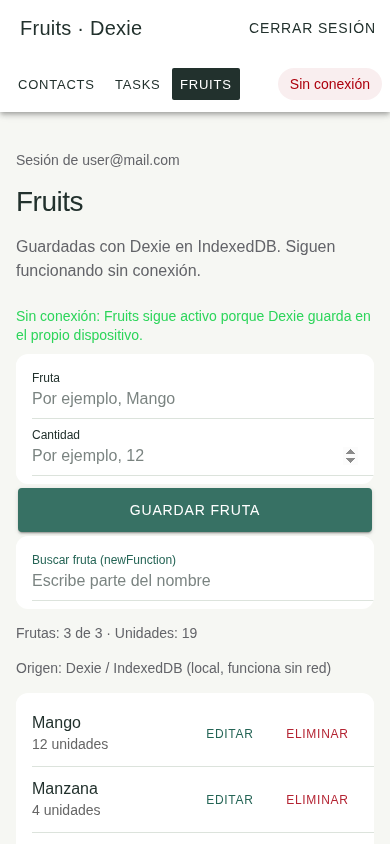

# Challenge 06 - Storage & Sensors

## Enunciado (Clase 07 - Storage & Sensors)

Implement a new app in ionic with real login and routes to handle, based on the
previous challenges:

- Contacts in Firebase.
- Tasks in RealTime.
- Fruits in Dexie - newFunction.

Validate if you have network connection, then enable or disable Contacts and
Tasks actions depending on the network connection.

## Checklist

- [x] App nueva en Ionic React + Vite
- [x] Login real con Firebase Auth (`signInWithEmailAndPassword`, `onAuthStateChanged`, `signOut`)
- [x] Rutas manejadas con `@ionic/react-router` (`/login`, `/contacts`, `/tasks`, `/fruits`) y rutas protegidas
- [x] Contacts guardados en **Cloud Firestore** (`collection`, `addDoc`, `updateDoc`, `deleteDoc`, `onSnapshot`)
- [x] Tasks guardadas en **RealTime Database** (`getDatabase`, `ref`, `onValue`, `push`, `set`, `update`, `remove`)
- [x] Fruits guardadas en **Dexie** (IndexedDB) con `useLiveQuery`
- [x] `newFunction` sobre la tabla de frutas: búsqueda viva + conteo de coincidencias y unidades
- [x] Estado de red con **@capacitor/network**
- [x] Sin conexión se deshabilitan las acciones de Contacts y Tasks
- [x] Sin conexión Fruits sigue funcionando porque Dexie es local
- [x] Toda la lógica de datos en custom hooks: `useAuth`, `useContactsFirestore`, `useTasksRealtime`, `useFruitsDexie`, `useNetwork`
- [x] Pruebas end-to-end con Playwright (9 pruebas) y capturas

## Patrón Custom Hook + Component

Igual que en clase, ningún componente llama a Firebase ni a Dexie. Cada fuente
de datos tiene su hook y el componente solo consume lo que el hook devuelve.

| Fuente | Custom hook | Componente |
| --- | --- | --- |
| Firebase Auth | `src/hooks/useAuth.js` | `src/pages/Login.jsx` |
| Cloud Firestore | `src/hooks/useContactsFirestore.js` | `src/components/Contactos.jsx` |
| RealTime Database | `src/hooks/useTasksRealtime.js` | `src/components/Tareas.jsx` |
| Dexie / IndexedDB | `src/hooks/useFruitsDexie.js` | `src/components/Frutas.jsx` |
| @capacitor/network | `src/hooks/useNetwork.js` | `src/components/EstadoRed.jsx` |

`useAuth` y `useNetwork` se comparten con dos contextos muy pequeños
(`src/contexts/`) para no abrir dos veces el mismo oyente.

## La newFunction

El enunciado pide "Fruits in Dexie - **newFunction**". La función extra está en
`src/hooks/useFruitsDexie.js` y se llama literalmente `newFunction`.

Es una **búsqueda viva sobre la tabla `frutas` de Dexie**: recibe un texto,
filtra por nombre sin importar mayúsculas y, de paso, devuelve el conteo de
coincidencias y la suma de unidades.

```js
const resumen = useLiveQuery(
  async () => {
    const texto = filtro.trim().toLowerCase();
    const coincidencias = texto
      ? await db.frutas.orderBy('nombre')
          .filter((fruta) => fruta.nombre.toLowerCase().includes(texto))
          .toArray()
      : await db.frutas.orderBy('nombre').toArray();
    return {
      filas: coincidencias,
      total: coincidencias.length,
      unidades: coincidencias.reduce((suma, f) => suma + Number(f.cantidad ?? 0), 0),
    };
  },
  [filtro],
  { filas: [], total: 0, unidades: 0 },
);

const newFunction = useCallback((texto) => setFiltro(texto ?? ''), []);
```

Al ir dentro de `useLiveQuery`, se recalcula sola cada vez que cambia la tabla o
el texto buscado: si agregas una fruta mientras hay un filtro escrito, el conteo
se actualiza sin recargar nada. En la pantalla es el campo
*"Buscar fruta (newFunction)"* y la línea *"Frutas: 2 de 3 · Unidades: 16"*.

## Red: habilitar y deshabilitar Contacts y Tasks

`useNetwork` lee el estado con `Network.getStatus()` y se queda escuchando
`Network.addListener('networkStatusChange', ...)` de `@capacitor/network`. Como
respaldo en navegador también escucha los eventos `online` / `offline` de la
ventana, que es lo que se puede forzar desde las pruebas.

Con eso:

- **Contacts** (Firestore) y **Tasks** (RealTime Database) son remotos: sin
  conexión se deshabilitan los inputs, el botón de guardar, el de editar, el de
  eliminar y el checkbox de completar, y aparece un aviso en rojo.
- **Fruits** (Dexie) es local: no se deshabilita nada y aparece un aviso en
  verde recordando que sigue funcionando sin red.

La prueba `tests/sin-red.spec.js` corta la conexión de verdad con
`context.setOffline(true)` y comprueba las dos cosas.

## Configuración de Firebase

Copia `.env.example` a `.env` y pega los datos de tu proyecto:

```bash
cp .env.example .env
```

```
VITE_FIREBASE_API_KEY=...
VITE_FIREBASE_AUTH_DOMAIN=...
VITE_FIREBASE_PROJECT_ID=...
VITE_FIREBASE_APP_ID=...
VITE_FIREBASE_DATABASE_URL=https://<project-id>-default-rtdb.firebaseio.com
```

En la consola de Firebase hay que habilitar **Authentication → Email/Password**,
crear la base de **Firestore** y la de **RealTime Database**.

### Modo local (importante, para ser honesto)

**Esta entrega no viene conectada a un proyecto de Firebase real**: no tengo
claves que subir al repositorio. El código de Firebase sí es el real (se usan
`firebase/auth`, `firebase/firestore` y `firebase/database` tal como en clase),
pero si las variables de entorno no están definidas la app arranca en *modo
local*: Auth, Firestore y RealTime Database se resuelven con una capa de
respaldo sobre `localStorage` (`src/services/respaldoLocal.js`) que expone
exactamente las mismas operaciones que los hooks.

- `hayFirebase` y `hayRealtime` (`src/services/firebase.js`) son los que deciden
  qué camino se toma.
- Los componentes **no se enteran**: poner el `.env` cambia a Firebase real sin
  tocar ni una línea de la interfaz.
- En modo local el login usa la cuenta de práctica del curso:
  **user@mail.com / 123**.
- **Dexie sí es real siempre**, porque IndexedDB es del propio navegador.
- La pantalla muestra de dónde salen los datos ("Origen: respaldo local
  (localStorage)" o "Origen: Cloud Firestore") para que no haya dudas.

## Cómo correrlo

Necesitas Node 22.12 o superior.

```bash
npm ci
npm run dev
```

Para revisar la versión que se publica:

```bash
npm run build
npm run preview
```

## Recorrido

Se entra en `/login`. Sin sesión, cualquier otra ruta devuelve al login; con
sesión, `/login` lleva a `/contacts`. Arriba hay una barra con las tres
secciones y un chip con el estado de la red.

- **Contacts**: nombre y teléfono, con crear, editar y eliminar.
- **Tasks**: título, marcar como completa y eliminar, con el contador de
  pendientes.
- **Fruits**: nombre y cantidad, crear, editar y eliminar, más el buscador de la
  `newFunction`.

Cerrar sesión limpia la sesión y vuelve al login; los datos siguen guardados.

## Pruebas

```bash
npx playwright install chromium
npm run build
npm test
```

Son 9 pruebas en una ventana de tamaño móvil:

| Archivo | Qué comprueba |
| --- | --- |
| `tests/login.spec.js` | rutas protegidas, credenciales que no coinciden, sesión que sobrevive a recargar, cerrar sesión |
| `tests/contacts.spec.js` | CRUD completo de Contacts y persistencia |
| `tests/tasks.spec.js` | CRUD completo de Tasks, completar y contador |
| `tests/fruits.spec.js` | CRUD completo de Fruits en Dexie y la `newFunction` filtrando y contando |
| `tests/sin-red.spec.js` | sin red: Contacts y Tasks deshabilitados, Fruits operativo, y todo se vuelve a habilitar al volver la conexión |
| `tests/capturas.spec.js` | genera las capturas de este README |

Como `IonRouterOutlet` deja las páginas anteriores montadas para animar las
transiciones, las pruebas buscan siempre dentro de la página activa
(`div.ion-page:not(.ion-page-hidden)`); ese ayudante está en `tests/ayudas.js`.

No se ha probado la instalación en un teléfono físico.

## Capturas











