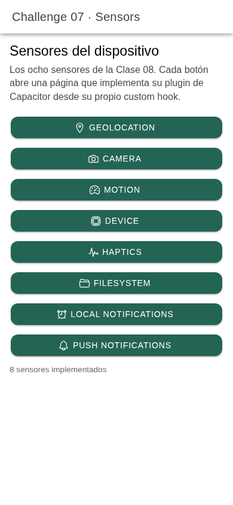
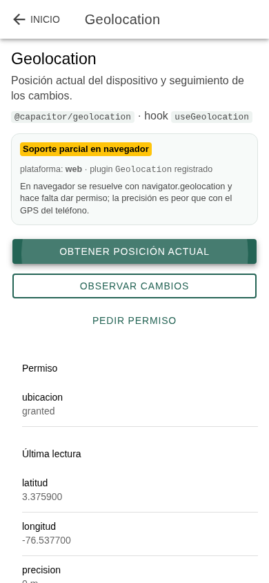
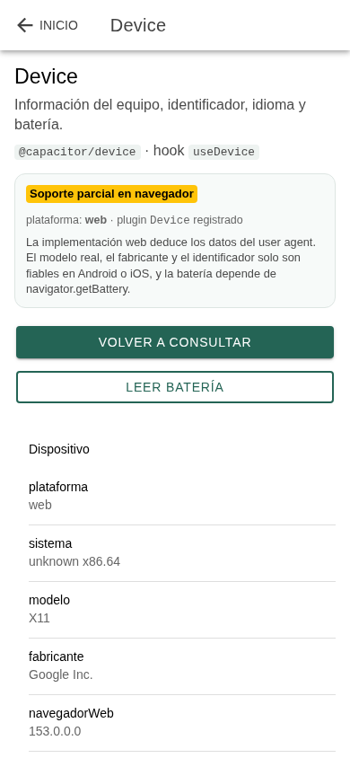
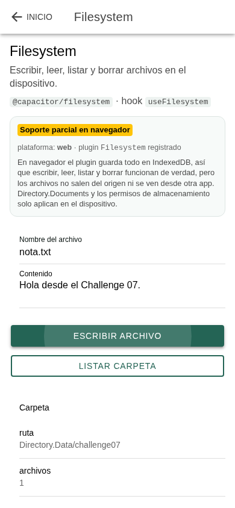
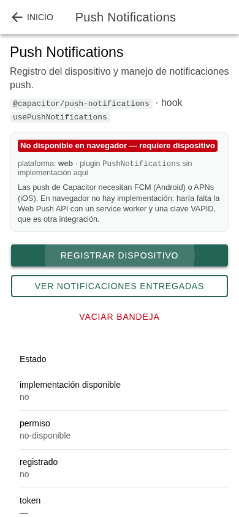

# Challenge 07 - Sensors

## Enunciado (Clase 08 - Sensors)

Create a new Empty App

Use a Home Page to create buttons (one foreach sensor)

Create one new page foreach sensor to implement each one of them

## Checklist

- [x] App vacía nueva de Ionic React + Vite
- [x] Home Page con un botón por cada sensor (ocho botones)
- [x] Una página nueva por sensor, con su ruta `/sensor/<nombre>`
- [x] `@capacitor/geolocation` — posición actual y seguimiento de cambios (`useGeolocation`)
- [x] `@capacitor/camera` — tomar foto, elegir de la galería y mostrarla (`useCamera`)
- [x] `@capacitor/motion` — eventos `accel` y `orientation` (`useMotion`)
- [x] `@capacitor/device` — info del equipo, identificador, idioma y batería (`useDevice`)
- [x] `@capacitor/haptics` — vibración, impacto, notificación y selección (`useHaptics`)
- [x] `@capacitor/filesystem` — escribir, leer, listar y borrar archivos (`useFilesystem`)
- [x] `@capacitor/local-notifications` — programar y cancelar notificaciones (`useLocalNotifications`)
- [x] `@capacitor/push-notifications` — registro y manejo de push (`usePushNotifications`)
- [x] Toda la lógica de cada sensor dentro de su custom hook, no en el componente
- [x] Cada hook detecta disponibilidad y muestra un estado claro en vez de romperse

## Cómo está armado

Se siguió el patrón **Custom Hook + Component** de la clase: un hook por sensor
en `src/hooks/` y una página en `src/pages/` que solo pinta lo que el hook le
entrega. Ningún componente llama directamente a un plugin de Capacitor.

```
src/
  sensores.js                 catálogo de los ocho sensores (lo usan Home, rutas y pruebas)
  App.jsx                     IonReactRouter: "/" y "/sensor/<nombre>"
  hooks/
    soporte.js                revisa plataforma, isPluginAvailable y traduce errores
    useGeolocation.js  useCamera.js  useMotion.js  useDevice.js
    useHaptics.js      useFilesystem.js  useLocalNotifications.js  usePushNotifications.js
  pages/
    Home.jsx                  los ocho botones
    Geolocation.jsx  Camera.jsx  Motion.jsx  Device.jsx
    Haptics.jsx      Filesystem.jsx  LocalNotifications.jsx  PushNotifications.jsx
  components/
    BotonSensor.jsx           botón de la Home
    PanelSensor.jsx           carcasa común: cabecera, plugin, hook y estado
    EstadoSoporte.jsx         la insignia de disponibilidad
    Datos.jsx                 listas de datos y avisos
```

`soporte.js` devuelve uno de tres niveles con `Capacitor.isNativePlatform()` y
`Capacitor.isPluginAvailable()`, y cada hook atrapa el error del plugin y lo
muestra en pantalla:

- **Disponible en este dispositivo** — corriendo en Android o iOS.
- **Soporte parcial en navegador** — hay implementación web o un respaldo, con límites.
- **No disponible en navegador — requiere dispositivo** — el plugin no tiene implementación web.

## Qué funciona en navegador y qué necesita dispositivo

Lo que sigue se comprobó de verdad con Chromium en esta máquina, no es una
suposición.

| Sensor | En navegador | Qué falta fuera del dispositivo |
| --- | --- | --- |
| Geolocation | Parcial: funciona | Usa `navigator.geolocation`, hay que dar permiso y la precisión es peor que la del GPS. |
| Camera | Parcial: con respaldo | `Camera.getPhoto` abre un selector de archivos y la cámara en vivo necesita `@ionic/pwa-elements`; por eso la página añade un respaldo con `<input type="file">`, que es lo que de verdad responde en escritorio. |
| Motion | Parcial: se registra, no llega nada | El plugin web escucha `devicemotion` y `deviceorientation`; un escritorio declara los eventos pero no tiene sensores, así que los valores vienen vacíos. En iOS además hay que aceptar el permiso. |
| Device | Parcial: funciona | Los datos salen del user agent: el modelo, el fabricante y el identificador solo son fiables en Android/iOS, y la batería depende de `navigator.getBattery`. |
| Haptics | Parcial: sin efecto real | Se traduce a `navigator.vibrate`, que en un escritorio no hace nada y en Safari no existe. El motor táctil fino (`impact`, `selection`) es exclusivo del dispositivo. |
| Filesystem | Parcial: funciona | Escribir, leer, listar y borrar funcionan sobre IndexedDB, pero los archivos no salen del origen ni los ve otra app. `Directory.Documents` y los permisos de almacenamiento solo aplican en el teléfono. |
| Local Notifications | Parcial: funciona con permiso | Se apoya en la API de Notificaciones y programa con `setTimeout`: al cerrar la pestaña se pierde lo pendiente. Canales, acciones y avisos exactos solo existen en Android/iOS. |
| Push Notifications | **No disponible** | `@capacitor/push-notifications` se registra sin implementación web: cualquier llamada falla. Necesita FCM (Android) o APNs (iOS); en web haría falta la Web Push API con service worker y clave VAPID. |

En resumen: **push-notifications no funciona en navegador** y
**motion y haptics se registran pero no producen nada real** sin un teléfono.
Los otros cinco sí se pueden probar desde el navegador con sus límites.

## Cómo correrlo

Necesitas Node 22.12 o superior.

```bash
npm ci
npm run dev
```

Para revisar la versión que se publica:

```bash
npm run build
npm run preview
```

Para probarlo en un teléfono de verdad:

```bash
npm run build
npx cap add android
npx cap sync
npx cap open android
```

## Recorrido

La Home lista los ocho sensores de la clase; cada botón abre `/sensor/<nombre>`.
Arriba de cada página aparece el plugin, el custom hook que lo maneja y la
insignia de disponibilidad con la explicación de la limitación.

En Geolocation se pide la posición y se puede dejar el seguimiento activo; si el
permiso se niega, el error se muestra en la página en vez de romperla. Camera
acepta la cámara, la galería o el respaldo de archivo. Motion engancha y suelta
los listeners de `accel` y `orientation` y lleva el conteo de eventos recibidos,
que es la forma honesta de ver si el sensor existe. Device consulta la
información al entrar. Haptics dispara vibración, los tres impactos, las tres
notificaciones y el ciclo de selección. Filesystem escribe, lista, lee y borra en
`Directory.Data/challenge07`. Local Notifications programa, lista y cancela.
Push Notifications deja el flujo de registro listo para Android/iOS y, en web,
avisa de que no hay implementación.

## Pruebas

```bash
npx playwright install chromium
npm run build
npm test
```

Son 22 pruebas con Playwright sobre la compilación de producción, en una ventana
de tamaño móvil y con un solo worker:

- la Home tiene los ocho botones y cada uno abre la página de su sensor;
- una prueba por sensor que entra a su página, revisa que renderiza su contenido
  y su estado de disponibilidad y que no lanza ningún error de JavaScript;
- pruebas de uso real: la posición con permiso concedido y con permiso negado, la
  info del dispositivo, el ciclo escribir/leer/borrar de Filesystem, la imagen de
  respaldo de Camera, los listeners de Motion, programar y cancelar una
  notificación local, y el aviso de que push no tiene implementación web.

Las capturas de `capturas/` las genera la propia suite (`npm run capturas`).
No se ha probado la instalación en un teléfono físico.

## Capturas











También están `capturas/camera.png`, `capturas/motion.png`,
`capturas/haptics.png` y `capturas/local-notifications.png`.
