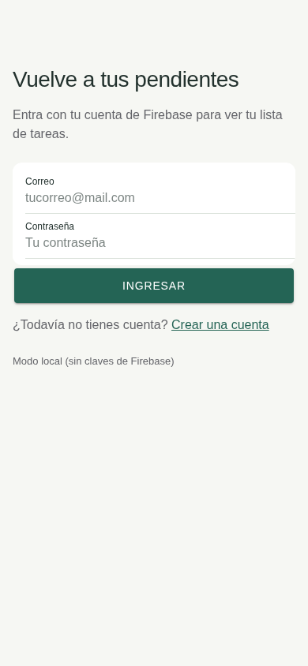
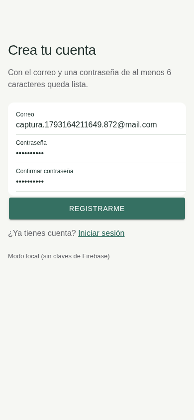
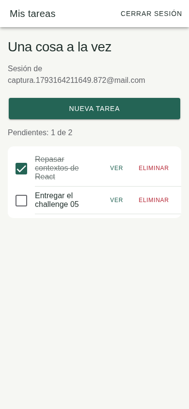
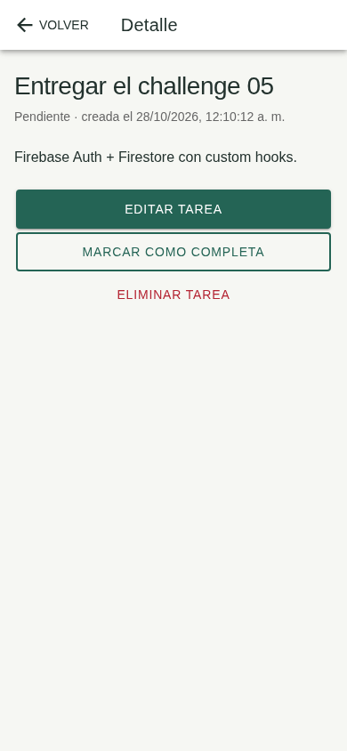
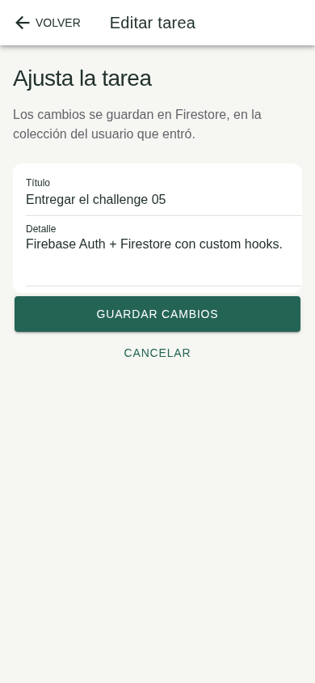

# Challenge 05 - Firebase, contexts y custom hooks

## Enunciado (Clase 06 - React)

Transform the Tasks App to add firebase Login/Register, custom hooks and contexts.

The app must contain:

- Login – Register – Logout with firebase
- routing pages: Login, Register, Tasks list, Add / Edit Task, Task Detail
- Use one context to handle Tasks data through pages.
- Use another context to handle login and Register data.
- Use custom hooks to handle Firebase logic

## Checklist

- [x] Login con Firebase Authentication (`signInWithEmailAndPassword`)
- [x] Register con Firebase Authentication (`createUserWithEmailAndPassword`)
- [x] Logout con Firebase Authentication (`signOut`)
- [x] Sesión persistente con `onAuthStateChanged`
- [x] Ruta `Login` (`/login`)
- [x] Ruta `Register` (`/register`)
- [x] Ruta `Tasks list` (`/tasks`)
- [x] Ruta `Add / Edit Task` (`/tasks/nueva` y `/tasks/:id/editar`, la misma página)
- [x] Ruta `Task Detail` (`/tasks/:id`)
- [x] Un context para las tareas (`TasksContext`)
- [x] Otro context para login y registro (`AuthContext`)
- [x] Los datos viajan por los contexts, no por props entre páginas
- [x] Toda la lógica de Firebase vive en custom hooks (`useAuthFirebase`, `useTasksFirebase`)
- [x] CRUD de tareas en Cloud Firestore por usuario (crear, listar, editar, detalle, borrar)
- [x] Rutas privadas: sin sesión, `/tasks*` redirige a `/login`
- [x] Pruebas end to end con Playwright
- [x] Capturas de las pantallas

## Patrón Custom Hook + Component

Como en las clases anteriores, cada funcionalidad queda en un custom hook y los componentes
solo la consumen. Ningún componente ni página importa `firebase/auth` o `firebase/firestore`.

| Capa | Archivo | Qué hace |
| --- | --- | --- |
| Hook | `src/hooks/useAuthFirebase.js` | `createUserWithEmailAndPassword`, `signInWithEmailAndPassword`, `signOut`, `onAuthStateChanged` |
| Hook | `src/hooks/useTasksFirebase.js` | `collection`, `query`, `where`, `orderBy`, `onSnapshot`, `addDoc`, `updateDoc`, `deleteDoc`, `getDoc` |
| Context | `src/contexts/AuthContext.jsx` | Publica el hook de auth a toda la app |
| Context | `src/contexts/TasksContext.jsx` | Publica el hook de tareas, usando el uid del AuthContext |
| Atajos | `src/hooks/useAuth.js`, `src/hooks/useTasks.js` | Leen cada context desde páginas y componentes |
| Páginas | `src/pages/*.jsx` | Solo pintan y llaman a lo que exponen los contexts |

## Rutas

| Ruta | Página | Acceso |
| --- | --- | --- |
| `/login` | `pages/Login.jsx` | pública (con sesión redirige a `/tasks`) |
| `/register` | `pages/Register.jsx` | pública (con sesión redirige a `/tasks`) |
| `/tasks` | `pages/Tareas.jsx` | privada |
| `/tasks/nueva` | `pages/TareaEditor.jsx` | privada |
| `/tasks/:id` | `pages/TareaDetalle.jsx` | privada |
| `/tasks/:id/editar` | `pages/TareaEditor.jsx` | privada |

## Configuración de Firebase

La app usa el SDK modular de Firebase (`firebase` v13) y lee la configuración de variables de
entorno de Vite. Para conectarla a un proyecto real:

1. Crear el proyecto en la consola de Firebase y habilitar **Authentication → Email/Password**
   y **Cloud Firestore**.
2. Copiar `.env.example` a `.env` y pegar los valores de la app web:

```bash
cp .env.example .env
```

```
VITE_FIREBASE_API_KEY=...
VITE_FIREBASE_AUTH_DOMAIN=...
VITE_FIREBASE_PROJECT_ID=...
VITE_FIREBASE_STORAGE_BUCKET=...
VITE_FIREBASE_MESSAGING_SENDER_ID=...
VITE_FIREBASE_APP_ID=...
```

3. Reglas sugeridas para la colección `tareas` (cada usuario solo ve lo suyo):

```
match /tareas/{tarea} {
  allow read, write: if request.auth != null && request.auth.uid == resource.data.uid;
  allow create: if request.auth != null && request.auth.uid == request.resource.data.uid;
}
```

**Modo local de respaldo (hay que decirlo claro):** esta entrega **no viene conectada a un
proyecto de Firebase real**, porque las claves no se suben al repositorio. Cuando faltan las
variables de entorno, `src/firebase/config.js` no llama a `initializeApp` y los custom hooks
usan `src/firebase/local.js`, una capa que imita el pedazo de Firebase que la app necesita
(cuentas y colección de tareas) guardando todo en `localStorage`. La interfaz que ven los
contexts y las páginas es exactamente la misma, así que poner el `.env` basta para que la app
hable con Firebase de verdad: no hay que tocar ni componentes ni contexts. El pie de las
pantallas de login y registro dice en cuál de los dos modos está corriendo.

Las pruebas de Playwright corren en modo local, que es lo que permite evaluarlas sin red ni
credenciales.

## Cómo correrlo

Necesitas Node 22.12 o superior.

```bash
npm ci
npm run dev
```

Para revisar la versión que se publica:

```bash
npm run build
npm run preview
```

## Recorrido

Al abrir la app se revisa la sesión con `onAuthStateChanged`. Sin cuenta, se entra por
**Crear una cuenta**: correo y contraseña de al menos 6 caracteres, repetida para confirmar.
Al registrarse la app queda logueada y abre `/tasks`.

La lista muestra el correo de la sesión y el contador de pendientes. Desde ahí se crea una
tarea (título y nota opcional), se marca o desmarca, se elimina, o se abre **Ver** para el
detalle. El detalle permite editar, cambiar el estado y borrar. Editar reutiliza la misma
página del formulario, pero con el `:id` en la ruta.

Recargar no pide volver a entrar: la sesión y las tareas se recuperan. Cerrar sesión limpia
el estado y manda a `/login`; escribir `/tasks` a mano sin sesión también lleva al login.

## Pruebas

```bash
npx playwright install chromium
npm run build
npm test
```

Son 13 pruebas en Chromium y ventana de tamaño móvil (390x844), con `workers: 1`. Cubren
registro, validaciones del formulario, login correcto e incorrecto, persistencia de la sesión
al recargar, logout, protección de rutas privadas, crear, editar, ver el detalle, marcar y
eliminar tareas, y la persistencia de las tareas. La prueba `tests/capturas.spec.js` es la que
genera los PNG de la carpeta `capturas/`, así que las imágenes siempre corresponden a la
versión que pasa. No se ha probado la instalación en un teléfono físico.

## Capturas










